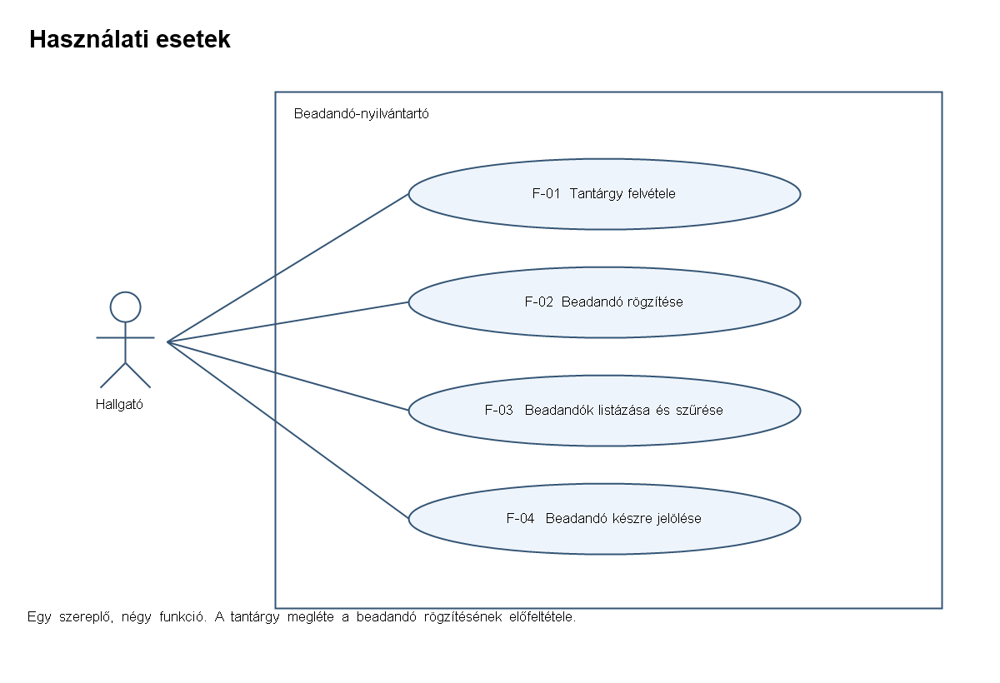
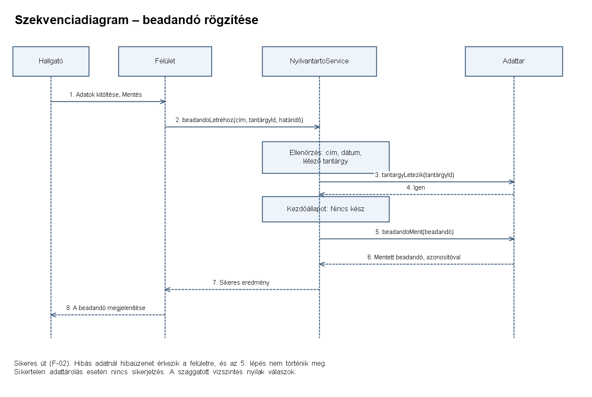
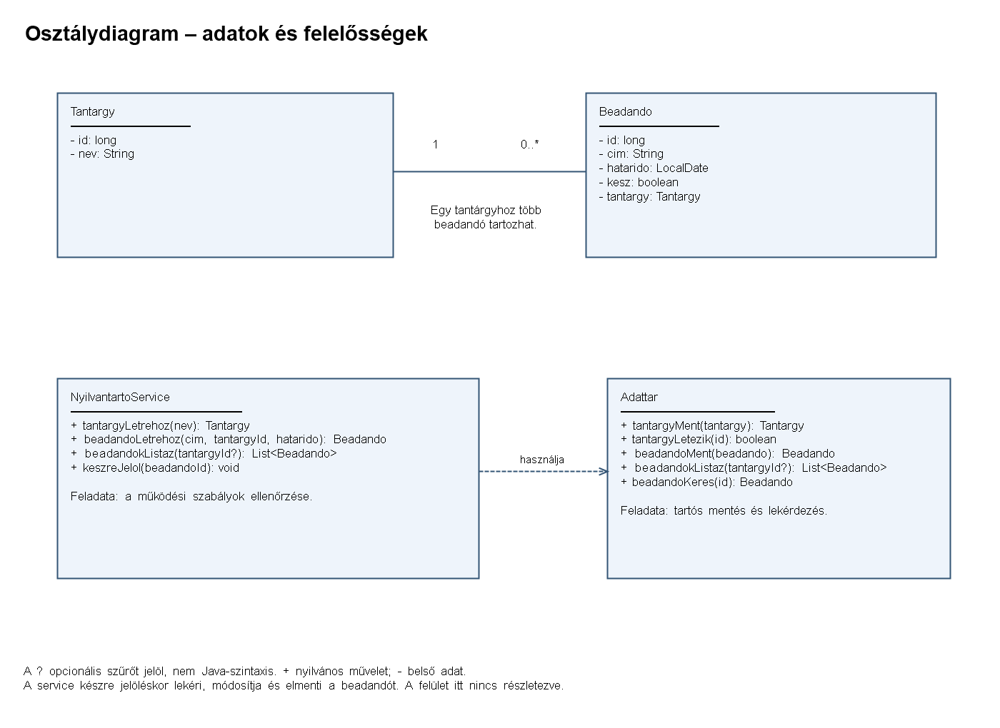

# Architektúra – 3. feladat

Ezek tervek, nem elkészült programot bemutató ábrák.
A kiindulópont a [követelménylista](../requirements.md).
Az architekturális döntés elfogadott; a megvalósítás ezt a tervet követi.

## Használati eset diagram (Use Case)

A hallgató négy műveletet végezhet: tantárgyat vesz fel, beadandót rögzít,
listáz és szűr, illetve készre jelöl. Az ábra F-01–F-04 követelményeit mutatja.

[Szerkeszthető változat](use-case.drawio)

A téglalap a rendszer határa, az oválisok a felhasználó céljai.
A tantárgy felvétele önálló művelet: meglévő tantárgynál nem kell minden
beadandóhoz megismételni, ezért nincs kötelező include kapcsolat.

## Szekvenciadiagram (Sequence)

Egy beadandó sikeres rögzítésének lépéseit mutatja időrendben, felülről lefelé (F-02).
A felület átadja az adatokat, a service ellenőrzi őket, az adattároló elmenti
a beadandót, majd a felület visszajelzést ad.

[Szerkeszthető változat](sequence-create-assignment.drawio)

A függőleges szaggatott vonalak életvonalak. A vízszintes szaggatott nyilak
válaszok. A felület résztvevő a képernyőt és annak kéréskezelését együtt jelöli;
a HTTP-részleteket az API-szerződés fogja megadni.
A hibás út az ábra alján szereplő megjegyzésben van összefoglalva:
hibás adatnál nincs mentés, sikertelen mentésnél nincs sikerjelzés.

## Osztálydiagram (Class)

A két adatosztályt és a két fő működési felelősséget mutatja.
A végleges kód további technikai osztályokat is tartalmazhat.

[Szerkeszthető változat](class-diagram.drawio)

- **Tantargy:** a tantárgy azonosítója és neve.
- **Beadando:** cím, határidő, állapot és a hozzá tartozó tantárgy.
- **NyilvantartoService:** a műveletek irányítása és a szabályok ellenőrzése.
- **Adattar:** tartós mentés és lekérdezés.
- **1 és 0..*:** minden beadandónak pontosan egy tantárgya van; egy tantárgynak
  nulla vagy több beadandója lehet.
- **boolean:** kétértékű adat; a kesz mező hamis vagy igaz.
- **LocalDate:** időpont nélküli naptári dátum.
- **List<Beadando>:** beadandókat tartalmazó lista.
- A műveletek paraméterei az olvashatóság érdekében rövidítettek.
  Az azonosítók long, a nevek és címek String, a határidő LocalDate típusúak.
  A ? jel azt jelenti, hogy a tantárgyszűrő elhagyható; ez nem Java-szintaxis.

## Tervezési döntés (ADR)

[ADR-001 – Egyszerű réteges Java-alkalmazás](adr/0001-layered-java-application.md)

Röviden: egy helyben futó Java-alkalmazás szolgálja ki a böngészős felületet;
a megjelenítés, a működési szabályok és a tartós adattárolás felelőssége különválik.

## Szerkesztés

A .drawio fájlok szerkeszthető XML-diagramok, a .png fájlok a hozzájuk tartozó
képi változatok. Módosításkor mindkét változatot frissíteni kell.
A diagramok magyar feliratokat, a kódhoz közeli osztály- és műveletnevek
ékezet nélküli Java-elnevezéseket használnak.
