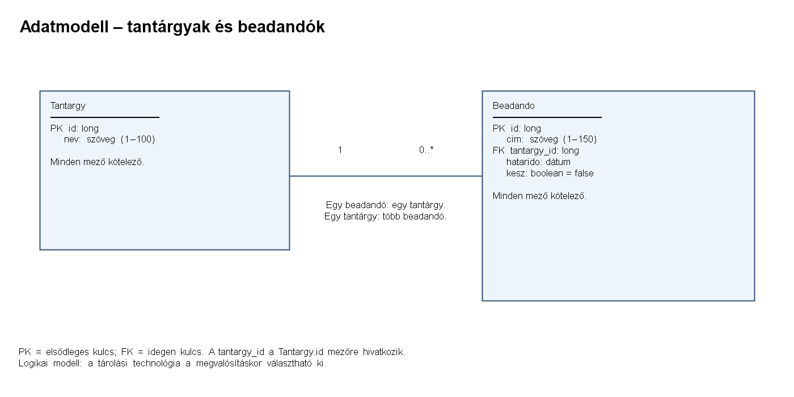

# Adatmodell (ERD)

[Szerkeszthető diagram](erd.drawio)

## Tantargy

| Mező | Logikai típus | Kényszer |
| --- | --- | --- |
| id | egész szám, Java long | Elsődleges kulcs (PK), egyedi, pozitív, nem null; a rendszer osztja ki. |
| nev | legfeljebb 100 karakteres szöveg | Nem null; a szélső szóközök eltávolítása után 1–100 karakter. |

## Beadando

| Mező | Logikai típus | Kényszer |
| --- | --- | --- |
| id | egész szám, Java long | Elsődleges kulcs (PK), egyedi, pozitív, nem null; a rendszer osztja ki. |
| cim | legfeljebb 150 karakteres szöveg | Nem null; a szélső szóközök eltávolítása után 1–150 karakter. |
| tantargy_id | egész szám, Java long | Idegen kulcs (FK) a Tantargy.id mezőre; nem null. |
| hatarido | naptári dátum, Java LocalDate | Nem null, érvényes dátum; múltbeli érték megengedett. |
| kesz | logikai érték, Java boolean | Nem null; alapérték false. |

## Kapcsolat és integritás

Egy tantárgyhoz nulla vagy több beadandó tartozhat (1 : 0..*).
Minden beadandó pontosan egy tantárgyhoz tartozik.
Nem létező tantárgy azonosítójával beadandó nem menthető.
A modell nem tartalmaz külön felhasználót, mert egyfelhasználós alkalmazást tervezünk.

A Tantargy.nev és a Beadando.cim nem egyedi mező.
A Java Beadando.tantargy objektumkapcsolat tárolási megfelelője a tantargy_id.
Az API ugyanezt tantargyId néven továbbítja.

Az adatmodell logikai terv; nem kötődik egy konkrét adatbázis-termékhez.
Relációs megvalósításkor PK, FK, NOT NULL és megfelelő CHECK kényszerek védik
az adatokat. Más tárolásnál az Adattar biztosítja ugyanezeket a szabályokat.
A service minden esetben ellenőrzi a bemenetet. A mentés tartós, hogy az NF-03
szerinti újraindítási próba teljesülhessen.

Törlési művelet nincs. Későbbi bővítéskor beadandóval rendelkező tantárgy
törlése nem hagyhat hátra hivatkozás nélküli beadandót.
