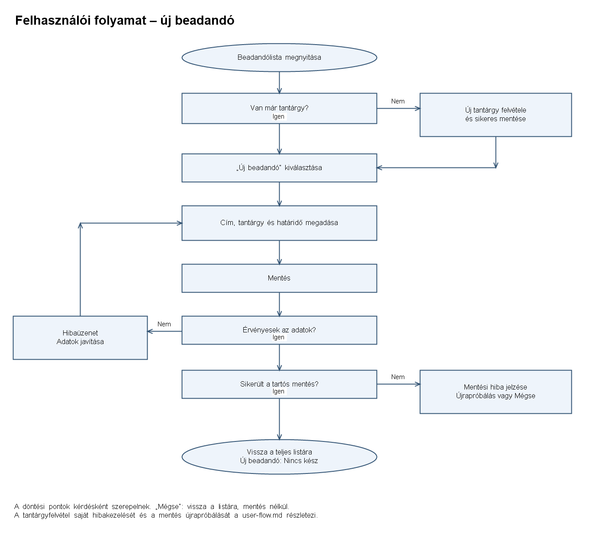

# Felhasználói folyamat

## Cél: beadandó rögzítése (F-01, F-02)

[Szerkeszthető változat](user-flow.drawio)

1. A hallgató megnyitja a beadandók listáját.
2. Ha nincs tantárgy, a felület tantárgy felvételére irányítja.
3. A hallgató beírja a tantárgy nevét és ment. Hibánál javít vagy újrapróbálkozik;
   csak sikeres mentés után lép tovább.
4. Az „Új beadandó” gomb megnyitja az űrlapot.
5. A hallgató megadja a címet, kiválasztja a tantárgyat és megadja a határidőt.
6. Mentéskor a rendszer ellenőrzi az adatokat.
7. Hibánál magyar üzenet jelenik meg, az adatok megmaradnak az űrlapon.
8. Sikeres tartós mentés után visszatér a listára. A szűrő „Összes tantárgy”
   értékre áll, így az új, „Nincs kész” beadandó biztosan látható.

A „Mégse” visszavisz a listára, mentés nélkül.
A folyamatábra a tantárgyfelvétel sikeres ágát vonja össze egy lépésbe;
a hibakezelés a fenti 3. pont szerint történik.

## Listázás és szűrés (F-03)

A lista induláskor minden beadandót mutat. A tantárgyszűrő kiválasztása frissíti
az eredményt; az „Összes tantárgy” feloldja a szűrést.
Üres eredménynél a felület szöveges tájékoztatást ad.

## Készre jelölés (F-04)

A hallgató megnyomja a sor „Készre jelölés” gombját.
Sikeres mentés után az állapot „Kész”, a gomb inaktív.
Sikertelen mentésnél hibaüzenet jelenik meg, és a kijelzett állapot nem változik.
A többi rekord és a tantárgyszűrő változatlan marad.

## Kapcsolódó képernyők

A [képernyővázlat](wireframes.md) megmutatja a listát és a két adatbeviteli űrlapot.
