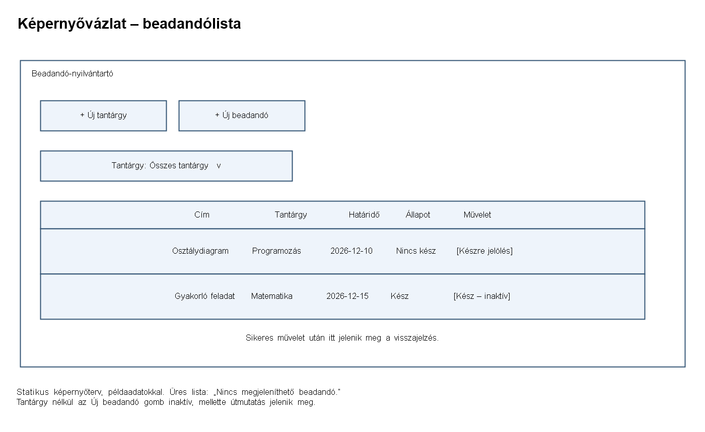
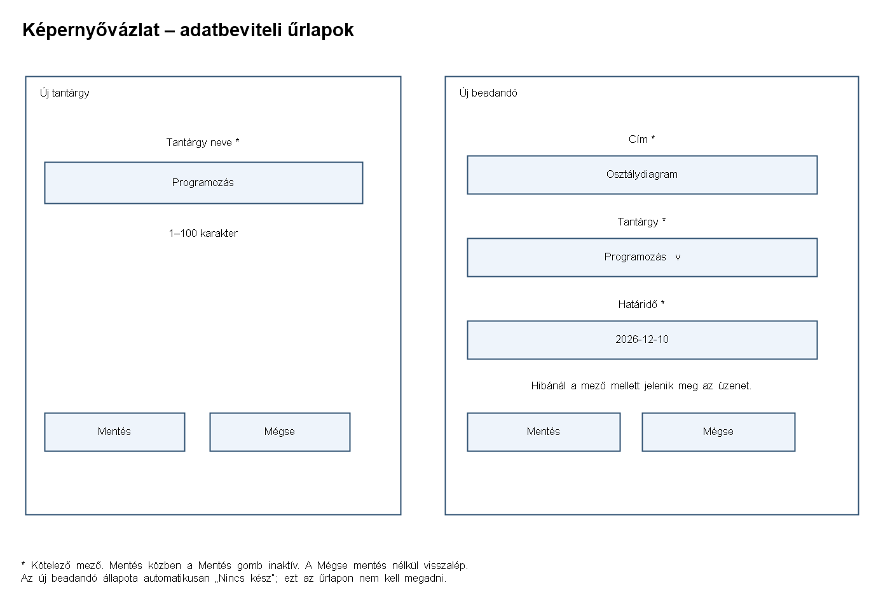

# Képernyővázlatok (Wireframe)

A vázlatok az elrendezést és a műveleteket mutatják. A példák illusztratívak,
nem tényleges hallgatói adatok. Nem működő alkalmazásról készült képernyőképek.

## 1. Beadandólista

[Szerkeszthető változat](wireframe-list.drawio)

- „Új tantárgy”: tantárgyfelvételi űrlap.
- „Új beadandó”: beadandófelvételi űrlap; tantárgy nélkül inaktív,
  mellette az „Először vegyél fel egy tantárgyat.” üzenet jelenik meg.
- A szűrőben azonos nevű tantárgyaknál az azonosító is látszik.
- „Készre jelölés” csak a nem kész sorokban használható.
- Üres eredmény: „Nincs megjeleníthető beadandó.”
- Sikertelen lekérdezés: hibaüzenet és „Újrapróbálás” gomb.

## 2–3. Adatbeviteli űrlapok

[Szerkeszthető változat](wireframe-forms.drawio)

- Minden mezőhöz látható magyar címke tartozik.
- A csillag a kötelező mezőket jelöli.
- A tantárgyválasztó a létező tantárgyakat sorolja fel.
- A hibaüzenet a hibás mező mellett jelenik meg; általános mentési hiba az űrlap alján.
- „Mégse”: visszalépés mentés nélkül.
- Mentés közben a mentés gomb inaktív, hogy ne induljon egyszerre több azonos kérés.
- A készültség nem szerepel a létrehozó űrlapon: az új beadandó mindig „Nincs kész”.
- Az űrlapok billentyűzettel is bejárhatók; a fókusz és a hibák szövegesen is felismerhetők.
